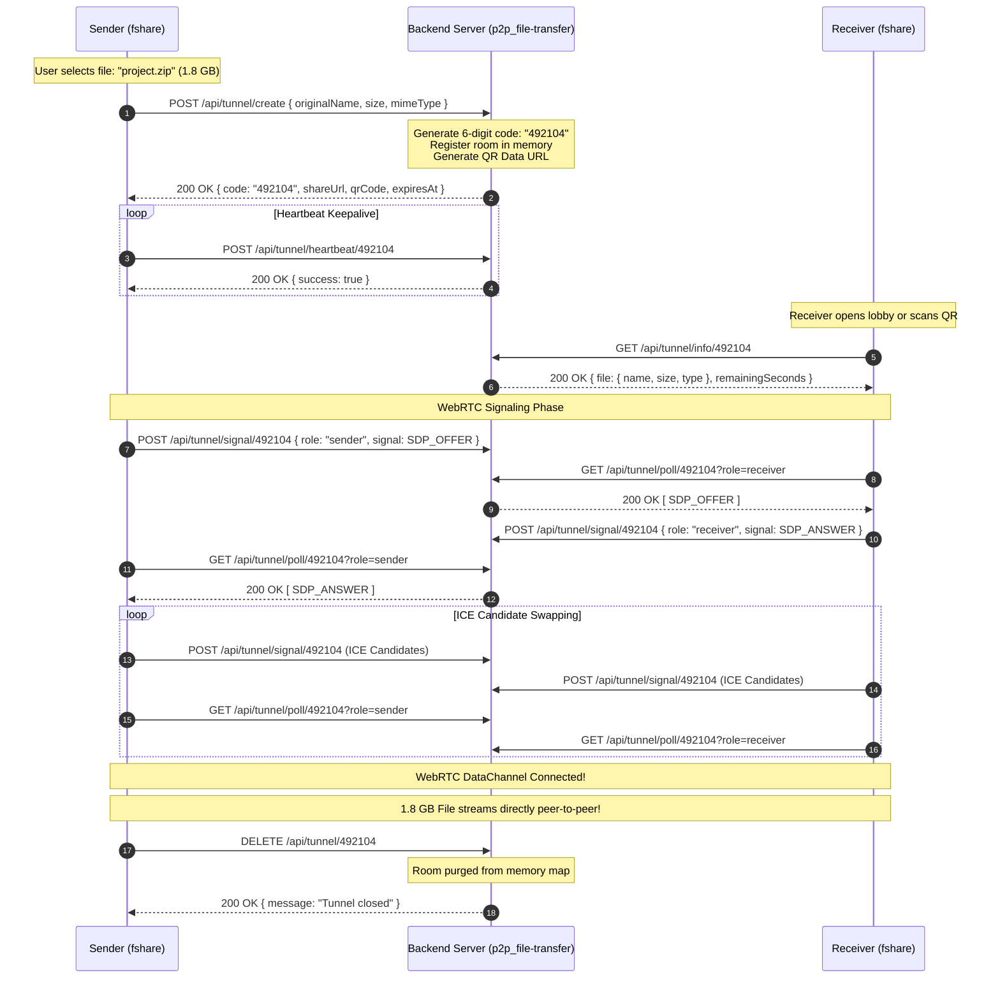
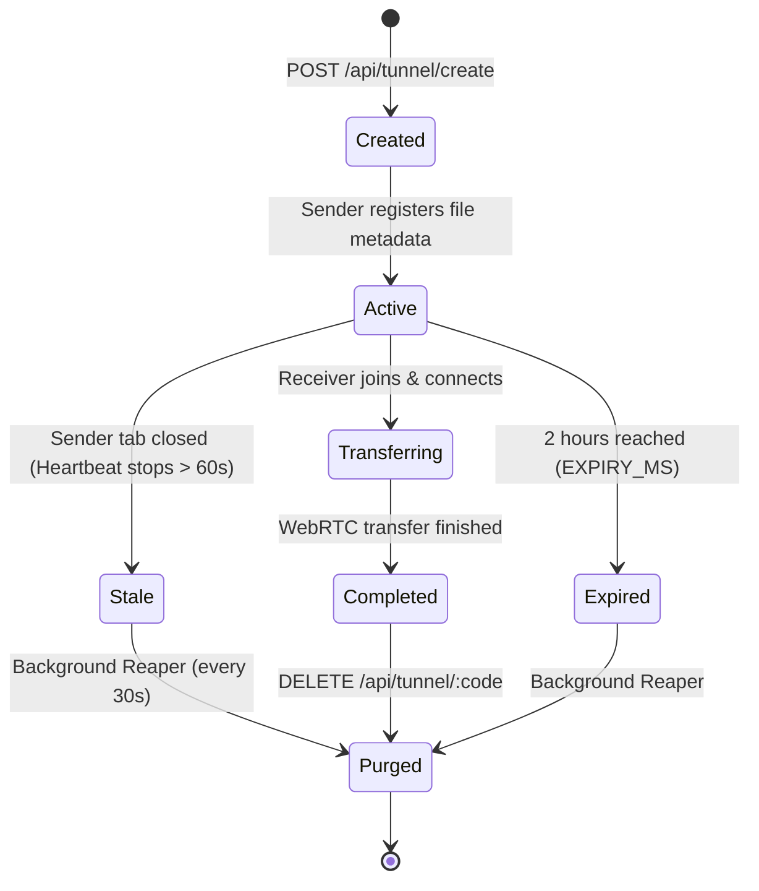

# 🌐 GhostDrop Backend — WebRTC Signaling & Tunneling Server

<div align="center">

[](https://nodejs.org/)
[](https://expressjs.com/)
[](https://webrtc.org/)
[](https://vercel.com/)
[](https://opensource.org/licenses/MIT)
[](https://developers.cloudflare.com/r2/)
[](../fshare)

<br />

### *High-Speed Matchmaker • Ephemeral Tunnel Management • 0 MB Server Storage Footprint*

</div>

---

## 📌 Companion Repositories

> **Note:** **GhostDrop** is an end-to-end distributed system composed of two symbiotic repositories:
> - **Signaling Backend (This Repo):** [`p2p_file-transfer`](https://github.com/your-username/p2p_file-transfer) — Express and Vercel Serverless matchmaking coordinator, ephemeral room manager, and signal exchange broker.
> - **Frontend Web Client:** [`fshare`](../fshare) — Modern React 19 / Vite P2P file streamer with backpressure flow control (`https://p2p-file-transfer-two.vercel.app` live backend).

---

## 📖 Executive Summary & Problem Solved

Traditional file hosting backends are expensive, legally precarious, and resource-heavy:
- **Massive Disk & Bandwidth Costs:** Storing multi-gigabyte files incurs exorbitant cloud storage (AWS S3, Cloudflare R2) and network egress fees.
- **Privacy Liabilities:** Keeping copies of user files creates compliance nightmares under GDPR, HIPAA, and data protection mandates.
- **Server Bottlenecks:** Centralized servers become choked under heavy concurrent uploads.

### The GhostDrop Architecture
The **GhostDrop Signaling Backend** completely inverts this paradigm:
1. **Zero File Storage:** The server **never touches, receives, or buffers any file binary data**. 
2. **Lightweight Matchmaker:** Its sole responsibility is establishing the initial peer-to-peer connection between browser clients via SDP (Session Description Protocol) offers, answers, and ICE network candidates.
3. **Stateless & Ephemeral:** Each active tunnel consumes less than `1 KB` of in-memory state and automatically expires after 2 hours (or within 60 seconds if the sender loses network connectivity).

---

## ✨ Key Features

- 🚀 **0 MB Disk & Server Storage:** Serves solely as an out-of-band signaling conduit; file contents stream peer-to-peer.
- 🤝 **Fast WebRTC Matchmaking:** Seamless exchange of SDP Offers, SDP Answers, and Interactive Connectivity Establishment (ICE) candidate packets.
- 📡 **Live Channel Discovery Lobby:** `/api/tunnel/active` endpoint enables recipients to discover active sending devices in real-time.
- 🎲 **Collision-Free 6-Digit Codes:** Instant numeric pin generation for quick human-friendly sharing between devices.
- 📱 **Integrated QR Code Generator:** Dynamically creates base64 QR codes linking directly to deep download URLs (`/#/download/:code`).
- 🧹 **Active Heartbeat & Ephemeral Room Reaper:** 
  - Senders dispatch lightweight heartbeats every 7 seconds.
  - Background scavenger runs every 30 seconds to purge abandoned rooms (idle > 60s) or sessions exceeding the 2-hour TTL.
- ⚡ **Dual Deployment Modes:** Runs as a persistent long-lived Node.js/Express service or as a zero-cold-start Vercel Serverless function (`api/index.js`).
- ☁️ **Hybrid Object Storage Ready:** Pre-configured with `@aws-sdk/client-s3` and pre-signers for optional Cloudflare R2 / AWS S3 hybrid deployments.

---

## 🏗️ System Architecture

```mermaid
flowchart LR
    subgraph Sender["Sender Client (fshare)"]
        S_FILE["Local File (Memory)"]
        S_P2P["WebRTC DataChannel Engine"]
    end

    subgraph Backend["GhostDrop Signaling Server (p2p_file-transfer)"]
        API["Express Router & Endpoints"]
        MAP[("In-Memory Tunnels Map (< 1KB / Room)")]
        QR["QR Code Engine (qrcode)"]
        REAPER["Room Reaper Cron (30s)"]
        
        API <--> MAP
        API --> QR
        REAPER --> MAP
    end

    subgraph Receiver["Receiver Client (fshare)"]
        R_UI["Download UI"]
        R_P2P["WebRTC DataChannel Engine"]
    end

    %% Signaling Interactions
    S_P2P -- "1. POST /api/tunnel/create" --> API
    API -- "2. Return 6-Digit Code & QR" --> S_P2P
    S_P2P -- "3. POST Heartbeat (every 7s)" --> API
    R_UI -- "4. GET /api/tunnel/active" --> API
    
    %% SDP / ICE Exchange
    S_P2P <-->|"5. POST /signal & GET /poll (SDP & ICE)"| API
    R_P2P <-->|"5. POST /signal & GET /poll (SDP & ICE)"| API

    %% Direct Transfer
    S_P2P ===|"6. Direct Encrypted SCTP WebRTC Stream (Zero Server Bandwidth)"|===> R_P2P
```

---

## 🔄 Signaling Handshake Sequence



---

## 💻 Tech Stack

| Component | Technology | Version | Purpose |
| :--- | :--- | :--- | :--- |
| **Runtime** | Node.js | `>= 18.0.0` | JavaScript server runtime |
| **Web Framework** | Express | `^4.21.0` | HTTP routing, CORS middleware, REST endpoints |
| **QR Code Engine** | qrcode | `^1.5.3` | Server-side base64 QR code rendering |
| **Identities** | uuid | `^9.0.1` | Collision-resistant session identifiers |
| **CORS Middleware** | cors | `^2.8.5` | Cross-Origin Resource Sharing control |
| **Configuration** | dotenv | `^16.4.5` | Environment variable parsing |
| **Cloud Storage SDK** | @aws-sdk/client-s3 | `^3.1149.0` | Cloudflare R2 / S3 object storage connector |
| **URL Presigning** | @aws-sdk/s3-request-presigner | `^3.1149.0` | Secure pre-signed PUT/GET upload URLs |
| **Media Management** | cloudinary | `^2.11.0` | Auxiliary media transformation |
| **Serverless Adapter** | @vercel/node | Vercel Spec | Stateless lambda execution |

---

## 📂 Repository Directory Structure

```text
p2p_file-transfer/
├── api/
│   └── index.js             # Vercel Serverless entry wrapper
├── .env.example             # Template for local & production configurations
├── .gitignore               # Ignored files (node_modules, local .env)
├── package.json             # Service metadata, dependencies & start scripts
├── package-lock.json        # Dependency lockfile
├── README.md                # Server architecture & documentation
├── server.js                # Core Express server, room state machine & API routes
└── vercel.json              # Vercel Serverless routing & CORS configuration
```

---

## ⚙️ Local Setup & Installation

### Prerequisites
- **Node.js**: v18.0.0 or higher
- **npm**: v9.0.0 or higher

### 1. Clone the Repository
```bash
git clone https://github.com/your-username/p2p_file-transfer.git
cd p2p_file-transfer
```

### 2. Install Dependencies
```bash
npm install
```

### 3. Configure Environment Variables
Copy `.env.example` to `.env`:
```bash
cp .env.example .env
```

Default configuration for `.env`:
```env
PORT=5000
EXPIRY_HOURS=2

# Optional: Cloudflare R2 / AWS S3 (for hybrid file hosting fallback)
# R2_ACCOUNT_ID=your_cloudflare_account_id
# R2_ACCESS_KEY_ID=your_r2_access_key_id
# R2_SECRET_ACCESS_KEY=your_r2_secret_access_key
# R2_BUCKET_NAME=your_r2_bucket_name
```

### 4. Start the Server

```bash
# Development mode with native Node watch auto-reload
npm run dev

# Production mode
npm start
```

The server will output:
```text
===============================================
🚀 GhostDrop P2P Streaming Server on port 5000
⚡ Mode: WebRTC Direct Tunnel (0 MB Server Storage)
📦 File Size Limit: UNLIMITED (Direct Peer Stream)
⏱️ Inactive session timeout: 2 hours
===============================================
```

Verify status by opening `http://localhost:5000` in your browser.

---

## 📖 Complete API Reference

All requests and responses use JSON (`Content-Type: application/json`).

### 1. System Health & Diagnostic Endpoints

#### `GET /`
Returns the operational health, active room count, and API directory.
- **Auth:** None
- **Response `200 OK`:**
```json
{
  "status": "online",
  "service": "GhostDrop P2P WebRTC Signaling Server",
  "storage": "0 MB (Direct Browser-to-Browser Streaming)",
  "fileSizeLimit": "Unlimited",
  "activeTunnels": 3
}
```

#### `GET /api/health`
Detailed diagnostic status for uptime monitoring services.
- **Auth:** None
- **Response `200 OK`:**
```json
{
  "status": "online",
  "mode": "p2p-webrtc-tunnel",
  "serverStorage": "0 MB (Direct Browser-to-Browser)",
  "fileSizeLimit": "Unlimited (Streamed directly via P2P)",
  "activeTunnels": 3,
  "expiryHours": 2,
  "serverTime": 1730000000000
}
```

---

### 2. Tunnel Management Endpoints

#### `POST /api/tunnel/create`
Registers a new P2P session with file metadata and produces a unique 6-digit code with a QR code.
- **Auth:** None
- **Request Body:**
```json
{
  "code": "492104",              // Optional: custom 6-digit code
  "originalName": "design.sketch", // Required
  "size": 154829104,               // File size in bytes
  "mimeType": "application/octet-stream"
}
```
- **Response `200 OK`:**
```json
{
  "success": true,
  "code": "492104",
  "tunnelId": "e2e9c5c7-920f-4886-bce7-7df15efc272a",
  "expiresAt": 1730007200000,
  "shareUrl": "https://ghostdrop.app/#/download/492104",
  "qrCode": "data:image/png;base64,iVBORw0KGgoAAAANSUhEUgAAA...",
  "file": {
    "name": "design.sketch",
    "size": 154829104,
    "type": "application/octet-stream"
  }
}
```

#### `POST /api/tunnel/heartbeat/:code`
Keepalive ping sent by active sender tabs every 7 seconds to keep their channel listed in the lobby.
- **Auth:** None
- **Response `200 OK`:** `{ "success": true, "code": "492104" }`
- **Response `404 Not Found`:** `{ "success": false, "message": "Tunnel not found" }`

#### `GET /api/tunnel/active`
Returns a list of all currently open tunnels awaiting receivers.
- **Auth:** None
- **Response `200 OK`:**
```json
{
  "success": true,
  "files": [
    {
      "id": "e2e9c5c7-920f-4886-bce7-7df15efc272a",
      "code": "492104",
      "originalName": "design.sketch",
      "size": 154829104,
      "mimeType": "application/octet-stream",
      "createdAt": 1730000000000,
      "expiresAt": 1730007200000,
      "remainingSeconds": 7192,
      "connected": false
    }
  ]
}
```

#### `GET /api/tunnel/info/:code`
Retrieves metadata and time-to-live for a specific room.
- **Auth:** None
- **Response `200 OK`:**
```json
{
  "success": true,
  "tunnel": {
    "id": "e2e9c5c7-920f-4886-bce7-7df15efc272a",
    "code": "492104",
    "file": {
      "name": "design.sketch",
      "size": 154829104,
      "type": "application/octet-stream"
    },
    "remainingSeconds": 7180,
    "connected": false
  }
}
```

#### `DELETE /api/tunnel/:code`
Purges an active room immediately upon transfer completion or tab unload.
- **Auth:** None
- **Response `200 OK`:** `{ "success": true, "message": "Tunnel closed" }`

---

### 3. WebRTC Signaling Conduit Endpoints

#### `POST /api/tunnel/signal/:code`
Submits an SDP description or ICE candidate packet to the room queue.
- **Auth:** None
- **Request Body:**
```json
{
  "role": "sender", // "sender" | "receiver"
  "signal": {
    "type": "offer", // "offer" | "answer" | "candidate"
    "sdp": "v=0\r\no=- ...",
    "candidate": null
  }
}
```
- **Response `200 OK`:** `{ "success": true }`

#### `GET /api/tunnel/poll/:code?role=:role`
Drains the opposing peer's signal queue. Calling this endpoint dequeues and clears the retrieved signals.
- **Parameters:** `role=sender` (retrieves receiver's signals) or `role=receiver` (retrieves sender's signals)
- **Response `200 OK`:**
```json
{
  "success": true,
  "signals": [
    { "type": "answer", "sdp": "..." },
    { "type": "candidate", "candidate": { ... } }
  ]
}
```

---

## 🧹 In-Memory Room Lifecycle & Garbage Collection

To prevent memory bloat and stale entries:


1. **Active Heartbeat:** Senders pulse `/api/tunnel/heartbeat/:code` every 7s.
2. **Reaper Cron:** Runs every 30 seconds (`cleanupExpiredTunnels`), evaluating `Date.now() >= expiresAt` or `now - lastHeartbeat > 60000`.
3. **Graceful Tab Unload:** Frontend dispatches `navigator.sendBeacon(/api/tunnel/:code)` for instant release.

---

## 🚀 Production Deployment

### Option A: Vercel Serverless (Recommended)
This repository includes a native `vercel.json` configuration configured for `@vercel/node`:

1. Fork or clone the repository to your GitHub account.
2. In the [Vercel Dashboard](https://vercel.com/new), import `p2p_file-transfer`.
3. Set environment variable: `EXPIRY_HOURS=2`.
4. Deploy! The `api/index.js` file handles all incoming requests serverlessly.

### Option B: Docker / VPS / Node.js
Deploy on any cloud provider (Ubuntu, Debian, AWS EC2, DigitalOcean):

```bash
# Install PM2 Process Manager
npm install -g pm2

# Start server in production mode
PORT=5000 pm2 start server.js --name "ghostdrop-backend"

# Ensure startup on server reboot
pm2 startup
pm2 save
```

---

## 🛡️ Security & Performance Best Practices

- **Zero Data Interception:** No binary data passes through the server; all streams are secured by WebRTC's peer-to-peer DTLS/SRTP cryptography.
- **CORS Configuration:** Configured to handle pre-flight `OPTIONS` requests and allow cross-origin communication between the frontend client and the signaling backend.
- **Rate & Payload Limiting:** Express payload limit is capped at `1 MB` (`express.json({ limit: '1mb' })`) because signaling messages strictly contain lightweight JSON metadata.
- **Strict DNS & In-Memory Isolation:** Room codes are randomly sampled across a `100,000` to `900,000` space with collision resolution to avoid accidental eavesdropping.

---

## 📄 License

This project is licensed under the **MIT License** — feel free to use, modify, and distribute it in open-source and commercial applications.
